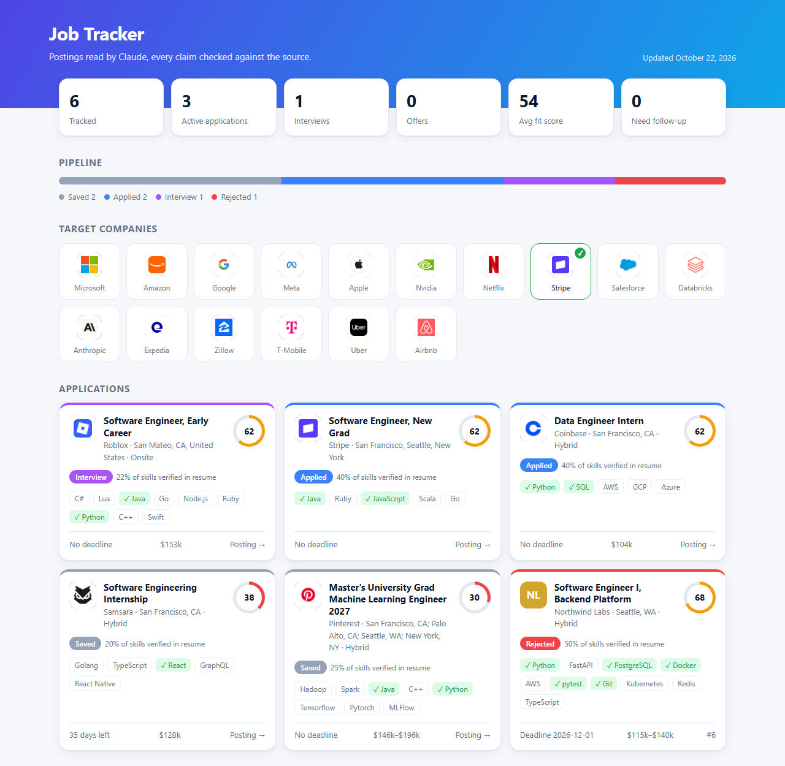

# jobtrack

[](https://github.com/hsandhu14/jobtrack/actions/workflows/tests.yml)

A command-line job application tracker. Claude reads each job posting, pulls out its details, and scores how well your resume fits. Plain Python code checks every claim the model makes before anything is saved.

It runs Claude Code in headless mode (`claude -p`), so it needs no API key, and it uses only the Python standard library.

**Measured on 20 real job postings:** company, role, deadline and salary were 100% correct, and 19 of 20 postings had all five fields right. Skill precision was 100% and recall 99%. See [eval/](eval/README.md).



```
$ python -m jobtrack add samples/posting1.txt
#1  Software Engineer I, Backend Platform @ Northwind Labs
  location: Seattle, WA (hybrid)   deadline: 2026-12-01   salary: $115,000-$140,000
  skills: Python, FastAPI, PostgreSQL, Docker, AWS, pytest, SQL databases, Git, CI/CD pipelines

$ python -m jobtrack match 1
  model score: 68/100   verified skill coverage: 78%
  + PostgreSQL: "Built a Flask REST API serving 2,000 daily requests, backed by PostgreSQL"
  - FastAPI
  - AWS
  tailored bullets:
    * Raised test coverage from 40% to 75% by writing pytest integration tests
```

## Who does what

The model's part is small and has clear limits. Everything it returns is treated as untrusted input.

| Step | Model (Claude, via `claude -p`) | Code (`validate.py`, `db.py`) |
|---|---|---|
| **Extract** | Reads a posting and returns company, role, location, work mode, required skills, deadline and salary as JSON | Enforces a JSON Schema. **Drops any skill that doesn't appear in the posting text.** Flags a company name that isn't in the posting. Rejects malformed or past deadlines, inverted salary ranges, and a salary when the posting mentions no pay. Removes duplicate skills. |
| **Match** | Scores resume fit 0–100, says which job skills the resume shows (quoting evidence), and rewrites up to 3 resume bullets for the posting | Rejects a score outside 0–100. **Drops any match whose evidence isn't a verbatim quote from the resume.** Drops "skills" that aren't on the job's list. **Drops rewritten bullets whose source line isn't in the resume or that contain numbers absent from the source** (no invented metrics). **Computes missing skills and coverage itself**, so they can't be hallucinated. |
| Everything else | — | Fetching postings, SQLite storage, status history, stale follow-up detection, the HTML dashboard, and per-call logging (latency, cost, claims made, claims dropped) |

Each model call runs with **no tools** (`--tools ""`), a task-specific system prompt, a JSON schema (`--json-schema`), and from a temp directory so no project context leaks in. When something looks wrong, `jobtrack stats` and the `!` lines in the output show whether the model said it or the code let it through.

## Setup

Requires Python 3.10+ and [Claude Code](https://claude.com/claude-code) logged in. The `claude` CLI is found on your PATH, or in the VS Code extension's bundled binary, or wherever `JOBTRACK_CLAUDE` points.

```bash
cp resume.example.md resume.md   # then put your real resume in it (gitignored)
python -m unittest               # 32 tests, no model calls
```

## Commands

| Command | What it does |
|---|---|
| `add <file\|url\|->` | Add a posting from a text file, a URL, or stdin |
| `match <id> [--resume path]` | Score your resume against a job |
| `list [--status s]` | Table of all jobs with their latest score |
| `show <id>` | Full details, status history and latest match |
| `status <id> <status> [--note]` | Move a job to `saved` / `applied` / `interview` / `offer` / `rejected` / `ghosted` / `withdrawn` |
| `stale [--days 14]` | Jobs you applied to that haven't changed status since |
| `stats` | Model calls, latency and how many model claims the validators dropped |
| `eval [--model m]` | Score extraction against 20 hand-labeled real postings ([details](eval/README.md)) |
| `dashboard [--out file]` | Write a static HTML dashboard: stat tiles, a pipeline bar, a strip of target companies, and a card for each job showing its company logo, fit score ring and skill chips (matched vs. missing) |

Environment variables: `JOBTRACK_DB` (default `data/jobtrack.db`), `JOBTRACK_MODEL` (default `sonnet`), `JOBTRACK_CLAUDE`.

Many job boards render their pages with JavaScript, so `add <url>` may find little text. In that case, paste the posting into a file and run `add file.txt --url <url>`.

### Dashboard logos

No logo images are stored in this repo. `logos.py` maps company names to their domains (about 50 well-known employers are built in), or reads the domain from the posting URL when that URL isn't a job board. The dashboard then loads each icon from Google's favicon service when you open the page. Any company without a domain, or whose icon fails to load, gets a colored monogram instead. Companies in the "Target companies" strip link to their careers pages and show a checkmark once you've added a job there. To change the list, create a `targets.txt` file with one company per line.

## Layout

```
jobtrack/
  llm.py        the only module that calls the model: prompts, schemas, CLI wrapper
  validate.py   pure checks on model output (fully unit-tested)
  db.py         SQLite schema and queries
  fetch.py      file/URL/stdin → plain text
  dashboard.py  static HTML report
  logos.py      company → domain/careers lookup and monogram fallback
  evaluate.py   scores extraction against eval/labels.json
  cli.py        argparse commands
tests/          unit tests for validators, scoring and logo lookup (run in CI)
eval/           20 real postings, hand labels, results per model
samples/        example postings
LOG.md          development log of plans and changes
```
